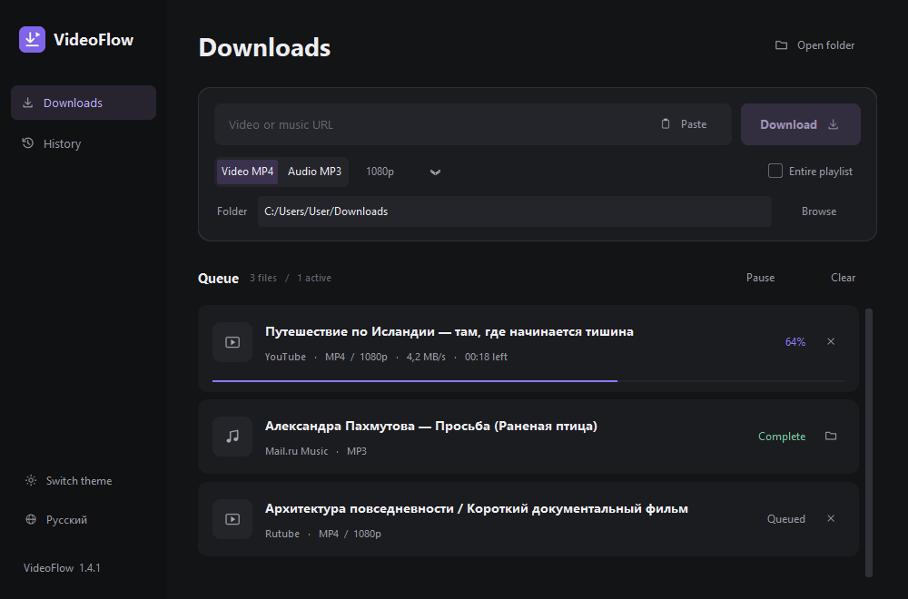

<p align="center"></p>

# VideoFlow

A compact Windows app for downloading public video and audio. Russian and English interfaces, dark and light themes, automatic URL analysis and a download queue.

[Русская инструкция](README.ru.md)



## Features

- YouTube, VK Video, OK, Rutube, Dzen, Yandex Video previews and public Mail.ru Music song pages.
- MP4 video up to the selected resolution; audio extraction to MP3.
- Automatic URL analysis after paste, with audio detection.
- Ctrl+V / Shift+Insert paste a link from anywhere in the app; Ctrl+L focuses the URL field. Text fields such as the destination folder keep normal paste behavior. Windows shortcuts also work with a Russian keyboard layout.
- Queue, progress, speed, remaining time, cancellation and pause before the next task.
- Folder, format, quality and playlist settings always visible.
- RU/EN language switching without restarting; local settings and history.
- One shared logo for the app, window and Windows executable.

Site support depends on the website, network and installed yt-dlp version. Private media, DRM and access-control bypass are not supported. Download only media you are allowed to save.

## Run

Windows 10/11 x64, Python 3.11+, FFmpeg in PATH for merging streams and extracting audio.

```powershell
py -m venv .venv
.venv\Scripts\python.exe -m pip install -r requirements.txt
.venv\Scripts\python.exe branding.py
.venv\Scripts\python.exe videoflow.py
```

Or double-click `run.bat`. For the packaged EXE, Python is not required. FFmpeg remains an external dependency.

## Build

```powershell
.venv\Scripts\python.exe -m pip install -r requirements-build.txt
.venv\Scripts\python.exe build_exe.py
```

The versioned EXE is written to `releases/<version>/`; the current copy is `dist/VideoFlow.exe`. Each release has a separate directory. `requirements-tested.txt` records the dependencies used for the supplied build.

The included Windows [GitHub Actions workflow](.github/workflows/build-windows.yml) builds the EXE and stores it as an artifact. It does not publish releases automatically. Action usage follows the official [checkout](https://github.com/actions/checkout), [setup-python](https://github.com/actions/setup-python) and [upload-artifact](https://github.com/actions/upload-artifact) documentation.

## Checks

```powershell
.venv\Scripts\python.exe -m unittest test_release.py
.venv\Scripts\python.exe ui_smoke_test.py
.venv\Scripts\python.exe smoke_test.py --download-pipeline
```

`ui_smoke_test.py` checks automatic analysis of a public Mail.ru track and requires network access. `smoke_test.py` checks public platform URLs; optional download tests use a temporary folder and remove their own files afterwards. The bundled EXE supports `--ui-smoke-test` (offline) and `--self-test` (network).

## Source layout

```text
videoflow.py        Application and interface
app.py              Queue, download engine and extractor adapters
i18n.py             RU/EN strings and display helpers
branding.py         Single logo source and PNG/ICO generation
build_exe.py        Windows executable build
assets/             Shared PNG and multi-size ICO
```

Settings and history are stored under `%APPDATA%/VideoFlow`. They are not part of the repository. The interface screenshots use sample tasks and a placeholder folder.

## License

No project license has been selected. This publication kit intentionally does not assign a license or an author identity. Third-party packages retain their own licenses; see [THIRD_PARTY.md](THIRD_PARTY.md).
