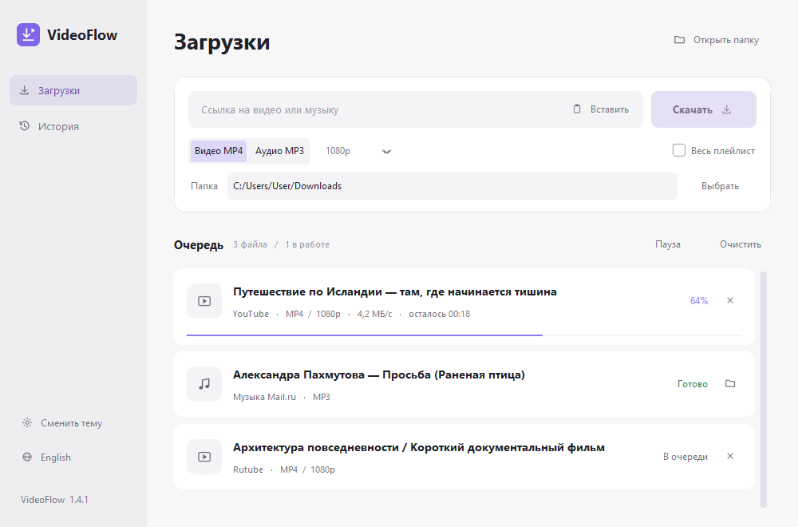

# VideoFlow 1.4.1

Минималистичный загрузчик видео и музыки для Windows с русским и английским интерфейсом.



Поддерживает публичные ссылки YouTube, VK, OK, Rutube, Дзен, предпросмотр Яндекс Видео и отдельные треки Музыки Mail.ru через yt-dlp и адаптеры VideoFlow.

- Анализирует ссылку после вставки автоматически.
- Ctrl+V и Shift+Insert вставляют ссылку из любого раздела приложения; Ctrl+L переводит фокус в поле ссылки. В поле папки сохраняется обычная вставка текста. Сочетания работают и в русской раскладке Windows.
- Сохраняет видео в MP4, извлекает звук в MP3.
- Показывает очередь, прогресс, скорость и оставшееся время.
- Все параметры доступны сразу: формат, качество, папка и плейлист.
- Кнопка в левом нижнем углу переключает RU/EN без перезапуска.
- Настройки и история остаются на компьютере, в `%APPDATA%/VideoFlow`.

## Запуск

Для EXE Python не требуется. Для объединения потоков и MP3 нужен FFmpeg в PATH.
Для запуска исходников установите Python 3.11+ и запустите `run.bat`.

```powershell
py -m venv .venv
.venv\Scripts\python.exe -m pip install -r requirements.txt
.venv\Scripts\python.exe branding.py
.venv\Scripts\python.exe videoflow.py
```

## Сборка

Запустите `build.bat`. Версионный EXE сохраняется в `releases/<версия>/`, актуальная копия — в `dist/VideoFlow.exe`. Python и зависимости интерфейса включаются в EXE; FFmpeg устанавливается отдельно.

## Публикация

В папке `release-assets` находится готовый EXE для прикрепления к GitHub Release. Эту папку не нужно добавлять в Git.
Лицензия проекта пока не выбрана; файл LICENSE намеренно не добавлен.

Скачивайте только материалы, которые вправе сохранять. Доступность источников зависит от изменений сайтов и сети; закрытый доступ и DRM не обходятся.
